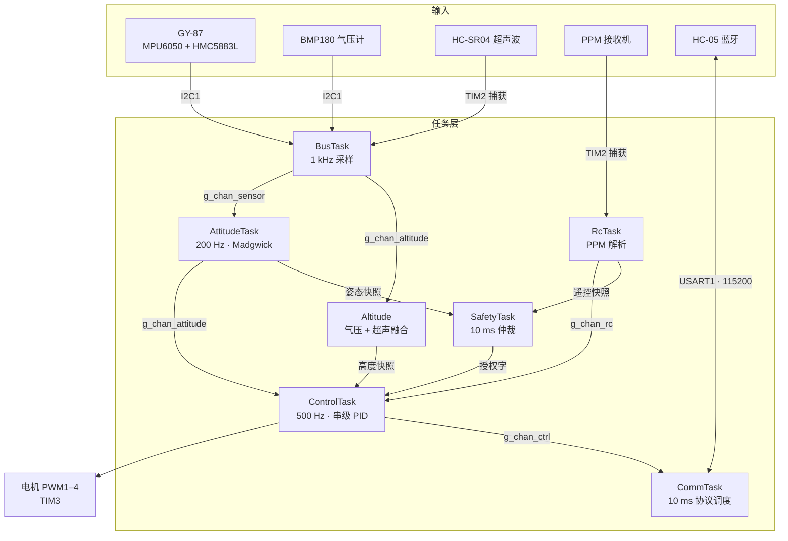
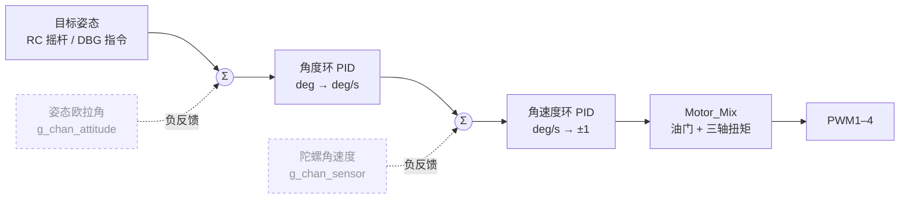

# F401 Flight Controller

基于 **STM32F401RET6** 的四旋翼飞控固件，采用 FreeRTOS + CMSIS-RTOS v2 架构，集成 Madgwick 姿态解算、串级 PID、定高辅助与匿名上位机 V7 通信协议。

> 状态：开发中（地面调试阶段）。全部任务链路已启用（含 `ControlTask` / `RcTask`），试飞前仍需拆除桨叶完成台架验证。

---

## 目录

- [功能特性](#功能特性)
- [硬件平台](#硬件平台)
  - [引脚分配](#引脚分配)
- [软件架构](#软件架构)
  - [主要模块](#主要模块)
  - [控制回路](#控制回路)
- [任务与调度](#任务与调度)
- [通信协议](#通信协议)
  - [帧格式（匿名协议 V7.15）](#帧格式匿名协议-v715)
  - [上行帧](#上行帧)
  - [参数 ID 分配](#参数-id-分配)
- [目录结构](#目录结构)
- [构建与烧录](#构建与烧录)
  - [环境要求](#环境要求)
  - [编译](#编译)
  - [修改外设配置](#修改外设配置)
- [快速开始](#快速开始)
- [开发约定](#开发约定)
- [已知限制](#已知限制)
- [参考资料](#参考资料)

---

## 功能特性

| 类别       | 内容                                                                                                    |
| ---------- | ------------------------------------------------------------------------------------------------------- |
| 姿态解算   | Madgwick AHRS，支持陀螺 / 6 轴 IMU / 9 轴 MARG 三档切换，磁力计可用性动态判定                           |
| 控制       | 姿态外环（角度→角速度）+ 角速度内环（串级 PID），500 Hz 内环 / 200 Hz 外环；D 项低通、积分限幅与抗饱和；PID 整定后可显式落盘掉电保持 |
| 定高辅助   | 气压计 + 超声波融合，CH7 一键起飞 / 定高 / 缓降状态机，含落地检测与悬停油门自学习                       |
| 安全层     | 独立 SafetyTask 状态机（DISARMED / ARM_PENDING / ARMED / FATAL），链路失效与超温超倾判据，看门狗门控    |
| 传感器校准 | 陀螺零偏、加计零偏/比例、磁力计硬磁/软磁，Flash 掉电保存                                                |
| 通信       | 匿名上位机 V7 协议（蓝牙 SPP），姿态/传感器实时上报 + PID 参数在线读写 + 日志窗口                       |
| 外设驱动   | I²C 异步事务（审计 + 降级 + 总线解锁自恢复）、UART 循环 DMA、PWM 输出、PPM 输入捕获                    |

---

## 硬件平台

- **MCU**：STM32F401RET6（LQFP64，512 KB Flash / 96 KB SRAM），开发板基于 NUCLEO-F401RE
- **时钟**：HSE 8 MHz → PLL（M=4, N=84, P=2）→ **SYSCLK 84 MHz**，APB1 42 MHz（定时器 84 MHz），APB2 84 MHz
- **RTOS**：FreeRTOS 10.x（CMSIS-RTOS v2 封装），heap_4，堆 32 KB

### 引脚分配

| 引脚        | 功能                                        | 说明                                  |
| ----------- | ------------------------------------------- | ------------------------------------- |
| PA0         | TIM2_CH1                                    | PPM 遥控输入捕获                      |
| PA1         | TIM2_CH2                                    | HC-SR04 ECHO                          |
| PA2 / PA3   | USART2_TX / RX                              | 预留调试串口                          |
| PA5         | GPIO 输出                                   | 板载绿色 LED                          |
| PA13 / PA14 | SWDIO / SWCLK                               | 下载调试                              |
| PB3 / PB10  | I2C2_SDA / SCL                              | OLED                                  |
| PB6 / PB7   | USART1_TX / RX（`BT_TX` / `BT_RX`）     | **HC-05 蓝牙 → 匿名上位机**    |
| PB8 / PB9   | I2C1_SCL / SDA（`IMU_SCL` / `IMU_SDA`） | **GY-87（MPU6050 + HMC5883L）** |
| PB12–PB15  | SPI2_NSS / SCK / MISO / MOSI                | 预留                                  |
| PC0         | GPIO 输出                                   | HC-SR04 TRIG                          |
| PC6–PC9    | TIM3_CH1–CH4                               | 电机 PWM1–PWM4                       |
| PC13        | EXTI13                                      | 板载按键                              |
| PD2         | GPIO 输出                                   | 蜂鸣器                                |
| PH0 / PH1   | HSE                                         | 8 MHz 晶振                            |

> 串口 1 默认 **115200 8N1**。使用 HC-05 时，模块自身的 UART 波特率必须同步改为 115200，否则上位机收到的将是乱码。

---

## 软件架构

数据以"快照 + 通道"方式在任务间单向流动，通道使用 seqlock 双缓冲（`atomic_publish.c`），读者无阻塞、无锁、无撕裂。



### 主要模块

| 文件                                                 | 职责                                                                         |
| ---------------------------------------------------- | ---------------------------------------------------------------------------- |
| `Core/Src/usart.c`                                 | USART1 循环 DMA 接收 + 单调写计数环形缓冲；TX 静态块池 + 队列 + DMA 链式发送 |
| `Mydrive/Src/anonym.c`                             | 匿名协议 V7 状态机、上行帧组包、参数读写（PID / 校准 / DBG）                 |
| `Mydrive/Src/gy87.c`                               | MPU6050 六轴 + HMC5883L 磁力计驱动，量程与 DLPF 配置                         |
| `Mydrive/Src/i2c_adapter.c`                        | I²C 异步事务封装：任务通知同步、链路审计、降级判定、9 时钟总线解锁恢复      |
| `Mydrive/Src/Madgwick.c`                           | 姿态融合三档降级策略与欧拉角输出                                             |
| `Mydrive/Src/calib.c`                              | 校准参数管理，Flash Sector 7 整页持久化（写前临时放宽 IWDG）                 |
| `Mydrive/Src/safety.c`                             | 安全状态机、故障位累积、看门狗门控                                           |
| `Mydrive/Src/atomic_publish.c`                     | seqlock 双缓冲通道，任务间无锁快照传递                                       |
| `Mydrive/Src/fc_time.c`                            | 基于 DWT CYCCNT 的微秒时间戳（无回卷累计误差）                               |
| `Mydrive/Src/altitude.c` `bmp180.c` `hcsr04.c` | 气压 / 超声测距与高度融合                                                    |
| `Mydrive/Src/pid.c` `motor.c` `rc.c` `ppm.c` | PID 运算、混控输出、遥控归一化、PPM 捕获                                     |

### 控制回路

外环（角度）与内环（角速度）均以 500 Hz 运行，外环目标由 RC 摇杆或上位机 DBG 指令给出，内环输出归一化扭矩后送混控：



---

## 任务与调度

| 任务             | 优先级       | 栈（字） | 周期                     | 职责                                        |
| ---------------- | ------------ | -------- | ------------------------ | ------------------------------------------- |
| `ControlTask`  | Realtime     | 512      | 2 ms（500 Hz）           | 串级 PID、定高辅助、混控输出                |
| `AttitudeTask` | High         | 768      | 5 ms（200 Hz，事件驱动） | Madgwick 解算并发布姿态快照                 |
| `SafetyTask`   | AboveNormal4 | 384      | 10 ms                    | 安全仲裁、状态机、喂狗                      |
| `RcTask`       | AboveNormal2 | 320      | 事件驱动                 | PPM 解析与遥控快照                          |
| `BusTask`      | Normal4      | 512      | 1 ms                     | IMU 采样（磁力计 10 Hz 抽取）、高度融合     |
| `CommTask`     | Normal       | 320      | 10 ms                    | 排空 RX 环形缓冲、协议解析、周期上报、TX 泵 |
| `DisplayTask`  | BelowNormal  | 256      | —                       | OLED 显示（占位）                           |
| `StatusTask`   | Low          | 192      | 200 ms                   | 堆余量与栈水位诊断                          |

---

## 通信协议

### 帧格式（匿名协议 V7.15）

| 字段 | HEAD          | D_ADDR   | ID     | LEN      | DATA     | SC     | AC       |
| ---- | ------------- | -------- | ------ | -------- | -------- | ------ | -------- |
| 长度 | 1 B           | 1 B      | 1 B    | 1 B      | n B      | 1 B    | 1 B      |
| 说明 | 固定 `0xAA` | 目标地址 | 功能码 | 数据长度 | 数据内容 | 和校验 | 附加校验 |

- 数据区小端；`SC` 为从 HEAD 到 DATA 末字节的 8 位累加和，`AC` 为 `SC` 的逐字节累加和。
- **安全通信**：参数写入（`0xE2`）、参数命令（`0xE0`）、参数读取请求（`0xE1`）等非显示类帧，飞控必须回 `0x00` 数据校验帧（携带原帧 `ID/SC/AC`），否则上位机会重试直至超时。

### 上行帧

| ID       | 内容                                             | 周期     |
| -------- | ------------------------------------------------ | -------- |
| `0x01` | 加速度 + 角速度（`int16`） + 震动状态          | 100 ms   |
| `0x02` | 磁力计原始值 + 气压高度 + 温度 + 状态位          | 100 ms   |
| `0x03` | 欧拉角（`×100`，单位度） + 融合状态           | 100 ms   |
| `0x04` | 四元数（`×10000`） + 融合状态                 | 10 ms    |
| `0xF1` | 调参波形：时间戳、姿态角、角速度、目标量、状态位 | 10 ms    |
| `0xA0` | LOG 文本（颜色 + ASCII 字符串）                  | 事件触发 |

### 参数 ID 分配

| ID 段      | 含义                          | 单位换算（协议值 = 物理量 × 倍率） |
| ---------- | ----------------------------- | ----------------------------------- |
| 2000–2002 | Roll 角度环 P / I / D         | ×100000                            |
| 2003–2005 | Pitch 角度环 P / I / D        | ×100000                            |
| 2006–2008 | Yaw 角度环 P / I / D          | ×100000                            |
| 2009–2011 | Roll 角速度环 P / I / D       | ×100000                            |
| 2012–2014 | Pitch 角速度环 P / I / D      | ×100000                            |
| 2015–2017 | Yaw 角速度环 P / I / D        | ×100000                            |
| 2018–2020 | 高度环 P / I / D              | ×100000                            |
| 1000–1002 | 加速度零偏 X / Y / Z          | ×1e5                               |
| 1003–1005 | 加速度比例 X / Y / Z          | ×1e5                               |
| 1006–1014 | 磁力计软磁矩阵（行优先 9 元） | ×1e5                               |
| 1015–1017 | 磁力计硬磁偏置 X / Y / Z      | ×1e5                               |
| 1018–1020 | 陀螺零偏 X / Y / Z            | ×1e5                               |

- 未使用的 ID 在读回时返回 `0x80000000`，上位机据此置灰对应参数行。
- 校准参数（1000–1020）在组末 ID 写入时触发一次 Flash 落盘。

完整协议见 [docs/匿名通信协议V7.md](docs/匿名通信协议V7.md)。

---

## 目录结构

```
F401-self/
├── Core/                 # STM32CubeMX 生成的外设初始化与中断入口
│   ├── Inc/              # HAL 配置、FreeRTOSConfig、外设句柄声明
│   └── Src/              # main.c / freertos.c / it.c / 各外设初始化
├── Drivers/              # CMSIS + STM32F4xx HAL 驱动（ST 官方）
├── Middlewares/          # FreeRTOS 源码（CMSIS-RTOS v2）
├── Mydrive/              # ★ 应用层：飞控业务与传感器驱动
│   ├── Inc/
│   └── Src/
├── MDK-ARM/              # Keil 工程（F401.uvprojx）与 RTE 配置
├── docs/                 # 协议与设计文档
├── F401.ioc              # CubeMX 工程源文件（唯一配置源）
└── .gitignore
```

---

## 构建与烧录

### 环境要求

| 工具            | 版本                          |
| --------------- | ----------------------------- |
| Keil MDK-ARM    | 5.32 及以上（ARM Compiler 5） |
| STM32CubeMX     | 6.16.1（如需重新生成工程）    |
| STM32Cube FW_F4 | V1.28.3                       |
| 调试器          | ST-Link（SWD）                |

### 编译

1. 用 Keil 打开 `MDK-ARM/F401.uvprojx`。
2. `Project → Build Target`（F7）编译，产物位于 `MDK-ARM/F401/F401.hex`。
3. `Flash → Download`（F8）烧录并复位。

### 修改外设配置

外设配置以 `F401.ioc` 为唯一来源。修改后由 CubeMX 重新生成代码，**用户代码必须写在 `/* USER CODE BEGIN */ ... /* USER CODE END */` 区间内**，否则会被覆盖。

---

## 快速开始

1. **配置蓝牙**：HC-05 的 UART 波特率设为 **115200**（AT 模式下发 `AT+UART=115200,0,0`），上电后与上位机完成 SPP 配对。
2. **连接上位机**：匿名上位机 V7 选择对应蓝牙虚拟串口，115200 打开。设备地址选 `0x05`（拓空者 PRO）即可正常读取参数。
3. **确认姿态**：静止平放时 `FC_ACC_Z ≈ 1000`、四元数 `V0 ≈ 10000`，3D 模型随横滚/俯仰转动。无磁力计校准时航向（yaw）会缓慢漂移，属正常现象。
4. **整定 PID**：参数页读写 2000–2020，F1 波形观察响应。修改即时生效（`ControlTask` 每拍从参数缓存拉取增益）。整定完成后由上位机发 `0xE0` / CID `0x45`（CMD0=`0xA5`）统一落盘——PID 与校准共用 Flash sector 7（两条记录同页重写，互不丢失），平时调参只改 RAM 不碰 Flash；已解锁状态拒绝落盘。
5. **传感器校准**：由独立校准工具通过 1000–1020 写入，组末自动落盘。

---

## 开发约定

- **中断优先级**：所有调用 RTOS API 的中断优先级必须数值 ≥ 5（`configLIBRARY_MAX_SYSCALL_INTERRUPT_PRIORITY`）。当前 TIM2 = 5、I²C1 EV/ER = 5、USART1 = 6、DMA2 Stream2 = 6、DMA2 Stream7 = 7；TIM3 / EXTI15_10（B1）中断已关闭；SysTick / PendSV / TIM4 = 15。
- **I²C 单写者**：I²C1 总线只允许 `BusTask` 直接触碰；其他任务改寄存器须走 `I2C_QueueSubmit()` 慢路径队列。
- **无运行期动态分配**：TX 使用静态块池，队列仅存指针，禁止在任务中 `malloc`。
- **数据结构传递**：跨任务共享一律通过 `FcChan_Publish` / `FcChan_Read` 快照通道，不共享裸指针。
- **时间基准**：统一使用 `Fc_GetMicros()`（DWT），不使用 `HAL_GetTick()`（Flash 擦除期间会停摆）。
- **中文注释**：代码注释统一使用中文，函数头采用 Doxygen 风格。

---

## 已知限制

- 航点读写帧（`0x60` / `0x61`）与校准命令帧（`0xE0` 的校准 CID）尚未实现，`0xE0` 仅回校验帧。
- `DisplayTask` 尚未接入 OLED 驱动。
- 高度融合与定高辅助仍在地面验证阶段，未经飞行验证。

> ⚠️ **安全声明**：本固件处于开发阶段。任何装机试飞前，请务必拆除桨叶完成台架验证，并确认 `SafetyTask` 的解锁与看门狗逻辑符合预期。

---

## 参考资料

- [匿名通信协议 V7.15](docs/匿名通信协议V7.md)
- Madgwick, S. *An efficient orientation filter for inertial and inertial/magnetic sensor arrays*, 2010.
- STM32F401RE Datasheet / Reference Manual RM0368
- FreeRTOS Kernel Documentation
